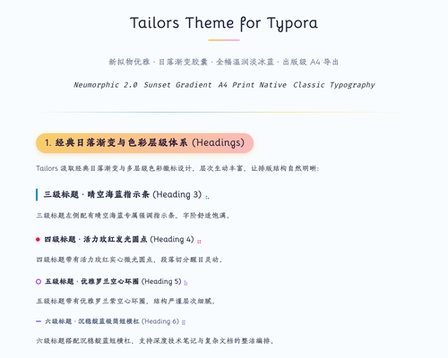

# Typora-Theme-Tailors  Introduction  [中文版](https://github.com/ChiamZhang/tailors.theme.typora/blob/gh-pages/Typora-Theme-Tailors%20%E4%B8%AD%E6%96%87%E4%BB%8B%E7%BB%8D.md)

## [HomePage](https://github.com/ChiamZhang/tailors.theme.typora)
## [DownLoad](https://github.com/ChiamZhang/tailors.theme.typora/raw/gh-pages/media/theme/tailors/tailors.zip)

## Introduction
This theme is inspired by my two favorite themes:

1. **Phycat** by XuJilong. Homepage: [GitHub - sumruler/typora-theme-phycat](https://github.com/sumruler/typora-theme-phycat) — *Mainly referencing the title system and sunset gradient capsule badges.*
2. **Typora-Theme-Neumorphism** by Soanguy. Homepage: [GitHub - Soanguy/Typora-Theme-Neumorphism](https://github.com/Soanguy/Typora-Theme-Neumorphism) — *Mainly referencing the soft neumorphic inline styling.*
3. I changed a lot of the colors and unnecessary hover CSS to make the overall style more compatible and pleasant for long reading. Since Soanguy hasn’t updated for a long time, I encountered some bugs while using it, which I fixed.
4. Continuous updates — if there are any issues, please feel free to raise them in the issue section, and I will fix them when I have time.
5. **Tailors** means that I have patched together this theme from various sources, feeling a bit embarrassed yet proud to share it with everyone!

---

## ✨ Latest Enhancements & Optimizations

- 🎨 **Unified & Soothing Canvas** — The entire editing window now shares the same soothing `#f7f9fc` paper tone, eliminating jarring pure-white cutout blocks.
- 📄 **A4-Native Reading & Full-Width Export** — Carefully calibrated to A4 paper proportions on screen (`860px` max reading width) and automatically expands to full-width A4 printable area when exporting to PDF.
- 🖨️ **Publisher-Grade PDF Export** — Automatically strips screen-only shadows, prevents awkward cross-page cutoffs, and eliminates all unwanted blue underlines and stray anchor dashes.
- 💻 **macOS-Style Code Blocks** — Fenced code blocks now feature a classic macOS red/yellow/green triple-dot header and WCAG AA compliant high-contrast syntax highlighting.
- 🔤 **Authentic Classical Typography** — Preserves the original font stack (`Bellota`, `Tw Cen MT`, `HYHuaGuan`, `霞鹜文楷`, `华文中宋`), while fixing the nested `strong` bold bug and restoring natural italic curves.
- 🚫 **Distraction-Free Blockquotes & Tables** — Removed overlapping circular decorative shapes from blockquotes; cleaned up table row hover jumpers.

---

## Usage & Installation

1. Download **[tailors.zip](https://github.com/ChiamZhang/tailors.theme.typora/raw/gh-pages/media/theme/tailors/tailors.zip)**.
2. In Typora, click **Preferences → Appearance → Open Theme Folder**.
3. Extract `tailors.zip` and place:
   - `tailors.css`
   - `tailors` folder (offline fonts)
   
   directly into your Typora theme folder.
4. Restart Typora or select **Tailors** from the **Themes** menu.



## Additional

Personalization can be done by changing the parameters in the `:root` module inside `tailors.css`.

---

# Title Styles

# First Level Title

## Second Level Title

### Third Level Title

#### Fourth Level Title

##### Fifth Level Title

###### Sixth Level Title

---

# Image Tips

1. **Quickly adjust the photo size**: Adjust any number in the positions below to the desired scaling percentage.

    <center><var>Method: <code></code> </var></center> 

    <center><var>For example: Adjust to 50% size <code></code> </var></center> 

    > Note: The default scaling size is set in steps of 5, i.e., 0, 5, 10, 15...

    

    

2. Note that photos cannot be adjusted to inline elements.

---

## HTML Elements Introduction

You can introduce customized badges through the `<var> </var>` element:
- <var>The original semantic meaning of this element is to define variables.</var>
- <var>Rendered as an elegant badge like this</var>

---

# Typographical Introduction

## Blockquote Style

> Absorb everyone's strengths and modify everyone's shortcomings.
>
> — *Tailors Design Principle*

## Inline Styles

Inline styles support **bold**, *emphasis*, `code`, <u>underline</u>, ~~strikethrough~~, $\LaTeX$, X^2^, H~2~O, ==highlight==, and [hyperlink](https://typora.io).

## Table Styles

|  Align Left   |       Align Center       | Align Right |
| :-----------: | :----------------------: | :---------: |
| Third column  | <u>Some lengthy text</u> |    $1600    |
| Second column |       Align center       |     $12     |
| Zebra stripes |        Very tidy         |     $1      |

## List Styles

1. Ordered list item 1.
2. Ordered list item 2.
   + Unordered sublist item 1.
     + Second-level unordered sublist item 1
   + Unordered sublist item 2.
     + [ ] Uncompleted item. Use `[ ]`
     + [x] Completed item. Use `[x]`

## Code Styles

```html
<!DOCTYPE html>
<html>
<body>

<h1>*= Operator</h1>
  
<p id="demo"></p>

<script>
var x = 10;
x *= 5;
document.getElementById("demo").innerHTML = x;
</script>

</body>
</html>
```

```cpp
#include <iostream>
using namespace std;

int main() {
    cout << "Hello, Tailors Theme!" << endl;
    return 0;
}
```

## Table of Contents

[TOC]
