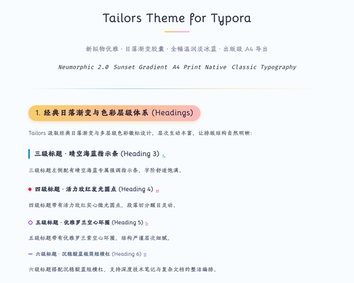

# Typora-Theme-Tailors 介绍 [English Version](https://github.com/ChiamZhang/tailors.theme.typora/blob/gh-pages/README.md)

## [项目主页](https://github.com/ChiamZhang/tailors.theme.typora)
## [离线下载包](https://github.com/ChiamZhang/tailors.theme.typora/raw/gh-pages/media/theme/tailors/tailors.zip)

## 主题起源

本主题借鉴了我最喜爱的两个经典主题：

1. **物理猫 Phycat**（作者：XuJilong）主页：[GitHub - sumruler/typora-theme-phycat](https://github.com/sumruler/typora-theme-phycat) —— *主要参考了标题体系与日落渐变胶囊样式*。
2. **Typora-Theme-Neumorphism**（作者：Soanguy）主页：[GitHub - Soanguy/Typora-Theme-Neumorphism](https://github.com/Soanguy/Typora-Theme-Neumorphism) —— *主要参考了微拟物内联组件风格*。
3. 优化了大量配色方案和不必要的悬停动画，使整体阅读更加协调舒适。针对 Soanguy 长时间未维护遗留的一些样式 Bug 进行了全面修复。
4. **持续维护更新**，如有任何使用建议或显示问题，欢迎在 GitHub Issue 中提出。
5. **Tailors（裁缝）**寓意着我将各家优秀设计细致缝合、裁剪融汇而成，既感惭愧，也满怀诚意呈现给各位 Markdown 爱好者！

---

## ✨ 最新升级与优化亮点

- 🎨 **全局统一护眼画布**：正文编辑区与窗口背景完美融为一体，采用柔和温润的 `#f7f9fc` 纸面底色，彻底告别原版突兀生硬的纯白贴纸感。
- 📄 **深度适配 A4 纸张排版**：屏幕端精校 A4 黄金阅读宽度（`860px`），导出 PDF 时自动铺满 A4 页面标准打印区域，不浪费纸面空间。
- 🖨️ **出版级纯净导出体验**：针对导出 PDF 与打印环境进行了专属净化，自动去除屏幕投影，彻底根除超链接多余的“蓝色横杠”与隐藏锚点伪影。
- 💻 **macOS 风格代码视窗**：代码块增设红黄绿三色控制圆点，高对比度重绘代码高亮，注释清晰易读，兼具美感与实用性。
- 🔤 **原汁原味古典字体传承**：完整保留原版特色字体栈（`Bellota`、`Tw Cen MT`、`HYHuaGuan` 汉仪花冠、霞鹜文楷、华文中宋），同时修复加粗嵌套语法失效问题。
- 🚫 **无遮挡清爽排版**：移除引用块右下角遮挡正文的大圆球装饰，去除表格悬停时突兀跳动的黄色底线。

---

## 安装与使用说明

1. 下载最新安装包 **[tailors.zip](https://github.com/ChiamZhang/tailors.theme.typora/raw/gh-pages/media/theme/tailors/tailors.zip)**。
2. 打开 Typora，点击菜单栏 **文件 -> 偏好设置 -> 外观 -> 打开主题文件夹**。
3. 解压 `tailors.zip`，将解压出的：
   - `tailors.css` 文件
   - `tailors` 字体文件夹
   
   直接拷贝到上述主题文件夹根目录下。
4. 重启 Typora 或在菜单栏 **主题** 中勾选 **Tailors** 即可享受全新排版！



## 个性化微调

如需微调字号或局部主色，可直接打开 `tailors.css` 修改顶部的 `:root` 变量。

---

# 标题样式展示

# 一级标题展示

## 二级标题：日落渐变胶囊

### 三级标题展示

#### 四级标题展示

##### 五级标题展示

###### 六级标题展示

---

# 图片排版技巧

1. **快速调节图片显示比例**：将方括号或引号中的数字修改为您期望的缩放百分比即可：

    <center><var>用法示例： <code></code> </var></center> 

    <center><var>例如缩放为 50% 大小：<code></code> </var></center> 

    > 注意：默认缩放步长以 5 为递进梯度（0, 5, 10, 15, ..., 100）。

    

    

2. 需要注意的是无法将图片调整为行内包裹元素。

---

## HTML 元素拓展

可以通过 `<var> </var>` 标签引入个性化徽章提示条：
- <var>该标签的原生语义是定义数学或程序变量。</var>
- <var>在这里渲染为一枚精致温暖的日落渐变胶囊徽标。</var>

---

# 常用排版与组件演示

## 引用块（Blockquote）

> 集大家之所长，改大家之所短。
>
> —— *Tailors 设计理念*

## 内联文字样式

支持 **加粗**、*斜体强调*、`行内代码胶囊`、<u>下划线衬底</u>、~~删除线~~、$\LaTeX$ 数学公式、上标 X^2^、下标 H~2~O、==荧光高亮== 以及 [网页超链接](https://typora.io)。

## 表格样式

|  左对齐列  |       居中对齐列       | 右对齐列 |
| :--------: | :--------------------: | :------: |
| 第一行内容 | <u>带下划线的长文本</u> |  $1600   |
| 第二行内容 |     居中展示数据项     |   $12    |
| 清爽斑马纹 |     行间距适中整齐     |    $1    |

## 列表与任务清单

1. 有序编号列表 1
2. 有序编号列表 2
   + 无序子列表项 A
     + 二级嵌套子列表项
   + 任务清单项：
     + [ ] 未完成的待办事项（输入 `[ ]`）
     + [x] 已完成的任务事项（输入 `[x]`）

## 代码块展示

```html
<!DOCTYPE html>
<html>
<body>

<h1>Tailors Theme</h1>
<p id="demo">Clean & Modern Typora Experience</p>

<script>
const theme = { name: "Tailors", layout: "A4-ready" };
console.log(`Loaded ${theme.name}`);
</script>

</body>
</html>
```

```cpp
#include <iostream>
using namespace std;

int main() {
    cout << "Hello, Tailors Markdown!" << endl;
    return 0;
}
```

## 目录（TOC）

[TOC]
