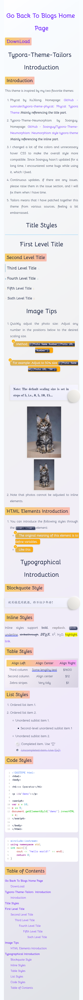

# Typora-Theme-Tailors 介绍 [English Version](https://github.com/ChiamZhang/tailors.theme.typora/blob/gh-pages/README.md)

> 一款集柔和新拟物化质感（Neumorphism）、日落渐变胶囊标题、全幅淡冰蓝底色与出版级 PDF 导出于一体的精制 Typora 主题。

[🌐 在线查看主题实时渲染效果 (Live HTML Preview)](https://chiamzhang.github.io/html/Typora-Theme-Tailors%20%20Introduction.html) | [⬇️ 下载离线安装包 (tailors.zip)](https://github.com/ChiamZhang/tailors.theme.typora/raw/gh-pages/media/theme/tailors/tailors.zip) | [⭐ GitHub 仓库](https://github.com/ChiamZhang/tailors.theme.typora)

---

## 💡 如何正确体验与展示本主题？

> [!IMPORTANT]
> **注意**：直接在 GitHub 或常规文本编辑器中浏览原生 `.md` 文件是**无法加载自定义 CSS 主题**的（只能显示无样式的纯文本）。
> 
> 若想体验或对外呈现 Tailors 主题的真正风采，有以下两种方式：
> 1. **在 Typora 中使用**：安装本主题后，在 Typora 顶部菜单【主题】选择 **Tailors**，享受所见即所得的精致写作体验；
> 2. **导出为独立网页 (HTML) 或 PDF**：
>    - **导出 HTML**：在 Typora 中点击【文件】→【导出】→【HTML（包含样式）】，生成的文件即可在任意电脑或浏览器中完美呈现主题的所有渐变标题、拟物标签与字体排版；
>    - **导出 PDF**：在 Typora 中点击【文件】→【导出】→【PDF】，全页无缝铺色并精准适配 A4 纸张排版。

---

## 主题起源

本主题借鉴了我最喜爱的两个经典主题：

1. **物理猫 Phycat**（作者：XuJilong）主页：[GitHub - sumruler/typora-theme-phycat](https://github.com/sumruler/typora-theme-phycat) —— *主要参考了标题体系与日落渐变胶囊样式*。
2. **Typora-Theme-Neumorphism**（作者：Soanguy）主页：[GitHub - Soanguy/Typora-Theme-Neumorphism](https://github.com/Soanguy/Typora-Theme-Neumorphism) —— *主要参考了微拟物内联组件风格*。
3. 优化了大量配色方案和不必要的悬停动画，使整体阅读更加协调舒适。针对 Soanguy 长时间未维护遗留的一些样式 Bug 进行了全面修复。
4. **持续维护更新**，如有任何使用建议或显示问题，欢迎在 GitHub Issue 中提出。
5. **Tailors（裁缝）**寓意着我将各家优秀设计细致缝合、裁剪融汇而成，既感惭愧，也满怀诚意呈现给各位 Markdown 爱好者！

---

## ✨ 核心特性与最新优化

- 🎨 **全幅淡冰蓝底色**：彻底摒弃传统白色卡片的生硬分界，屏幕编辑区与导出态全页统一为温润淡冰蓝（`#F9FCFF`），久读不累眼。
- 📐 **完全对齐 Typora 官方标准版芯**：
  - 默认版芯宽度 `860px`（标准内边距 `30px`，文末自带 `100px` 舒适留白）；
  - 宽屏（>1400px）与超宽屏（>1800px）自动无缝伸展至 `1024px` / `1200px`，完全对齐 GitHub / Night 官方主流主题行为。
- 🖨️ **出版级 A4 PDF 导出增强**：
  - 页面 0 外边距全幅无缝铺色，彻底根除打印引擎留下的外层纸张白边；
  - 彻底清除所有超链接的生硬蓝色与下划线，恢复纯净文本颜色；
  - 智能避免代码块、引用块在跨页接缝处被生硬切断。
- 💻 **精致 macOS 风格代码块**：代码块顶部带有经典红黄绿三色拟物圆点徽标，搭配高对比度语法高亮。
- 🔤 **原汁原味经典排版**：完整保留原版字体栈（`Bellota`、`Tw Cen MT`、`HYHuaGuan`、`霞鹜文楷`、`华文中宋` 等），字体无需系统额外安装。
- 🚫 **去除杂乱干扰元素**：移除引用块重叠的圆形悬停跳动图，表格隔行斑马纹温润整洁。

---

## 📦 安装与使用指南

1. 下载最新离线发布包 **[tailors.zip](https://github.com/ChiamZhang/tailors.theme.typora/raw/gh-pages/media/theme/tailors/tailors.zip)**。
2. 打开 Typora，点击顶部菜单栏：
   - macOS: **Typora → 偏好设置 → 外观 → 打开主题文件夹**
   - Windows/Linux: **文件 → 偏好设置 → 外观 → 打开主题文件夹**
3. 解压 `tailors.zip`，将解压出的文件直接放入主题文件夹内：
   - `tailors.css`（主题样式文件）
   - `tailors`（离线字体目录）
4. 重启 Typora，在顶部菜单栏【主题】列表中选中 **Tailors** 即可使用。

---

## 🎨 主题全貌视觉效果预览

以下为在 Typora 中应用 Tailors 主题导出的实际视觉效果预览长图（若无法直接加载，可查看 [在线 HTML 渲染效果页面](https://chiamzhang.github.io/html/Typora-Theme-Tailors%20%20Introduction.html)）：

---

## ⚙️ 个性化定制

如需调整主色调、字体栈或版面宽度，可直接打开 `tailors.css` 修改顶部的 `:root` 变量区。
