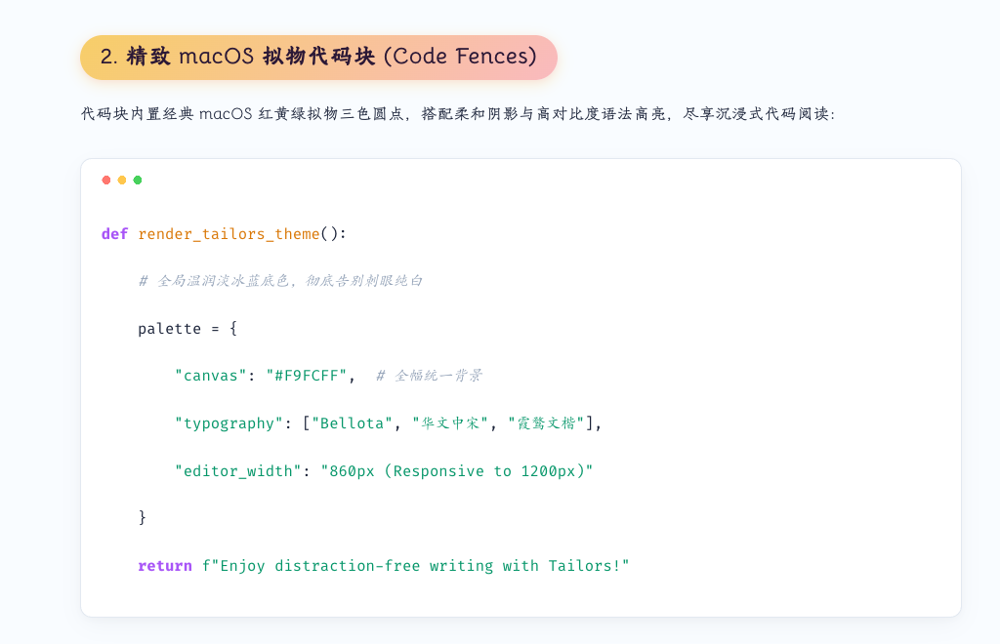
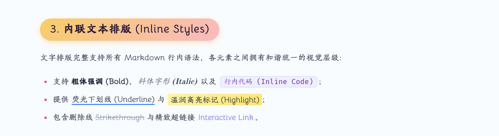
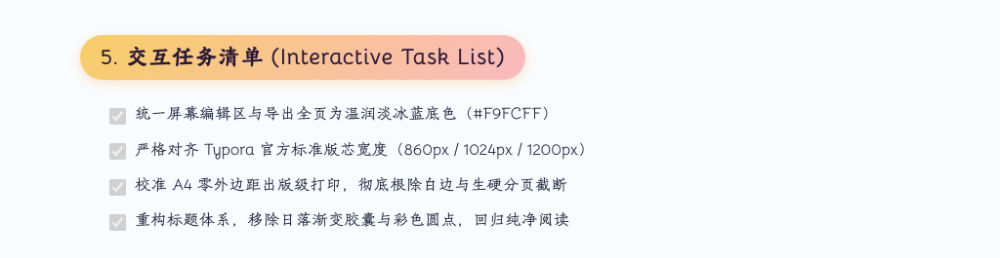

# Typora-Theme-Tailors 介绍 [English Version](https://github.com/ChiamZhang/tailors.theme.typora/blob/gh-pages/README.md)

> 一款集柔和新拟物化质感（Neumorphism）、清爽典雅经典排版、全幅温润淡冰蓝底色与出版级 PDF 导出于一体的精制 Typora 主题。

[🌐 在线查看主题实时渲染效果 (Live HTML Preview)](https://chiamzhang.github.io/tailors.theme.typora/preview.html) | [⬇️ 下载离线安装包 (tailors.zip)](https://github.com/ChiamZhang/tailors.theme.typora/raw/gh-pages/media/theme/tailors/tailors.zip) | [⭐ GitHub 仓库](https://github.com/ChiamZhang/tailors.theme.typora)

---

## 🎨 视觉效果展示 (Visual Showcase)

Tailors 深度融合经典日落渐变（Phycat）与柔和新拟物（Neumorphism）设计精髓，层次丰富灵动：

### 1. 经典日落渐变与色彩层级体系 (Headings)
- **H1 居中大标题**：底部配有专属日落渐变强调指示线；
- **H2 标志性日落渐变胶囊**：经典 `linear-gradient(to right, #f7ce68, #fbabfe)` 药丸徽标与微凸起质感；
- **H3 ~ H6 色彩标示与灵动点阵图案**：
  - **H3 晴空海蓝**：左侧精致高亮边框与 3 阶晴空蓝点阵；
  - **H4 活力玫红**：实心微光圆点徽标与 4 阶玫红点阵；
  - **H5 优雅罗兰**：精致空心环圈标示与 5 阶罗兰紫点阵；
  - **H6 沉稳靛蓝**：极简坚竖条与 6 阶深靛蓝点阵；
- **`<var>` 微拟物胶囊**：经典微凸起触感与渐变微发光标签。

---

### 2. 精致 macOS 拟物代码块 (Code Fences)
- 代码块顶部内置经典 **macOS 红黄绿三色拟物圆点徽标**；
- 柔和新拟物外层投影搭配高对比度语法高亮，尽享沉浸式代码阅读体验。

---

### 3. 内联文本排版 (Inline Styles)
- 完整支持所有 Markdown 行内语法，各元素之间拥有和谐统一的视觉层级；
- 针对 <u>荧光下划线 (Underline)</u> 采用清新晴空蓝（`#3b82f6`），告别沉闷纯黑；
- 完美呈现 ==温润高亮标记 (Highlight)==、**粗体强调**、*斜体字形*、`行内代码` 与删除线。

---

### 4. 优雅引用块与现代表格 (Quotes & Tables)
- **优雅引用块**：左侧带有经典日落渐变指示条与淡雅微光背景；
- **通透开阔现代表格**：配备日落渐变表头、柔和圆角卡片质感与隔行交替浅色斑马纹。

---

### 5. 交互任务清单 (Interactive Task List)
- 交互式复选框状态分明，已勾选任务带有平滑删除线与沉静色调；
- 纯净对齐，无多余跳动动画，带来专注高效的清单体验。

> 📸 **[点击查看主题全景长图 (Full Showcase Image)](media/theme/tailors/Introduction.png)**

---

## 主题起源

本主题借鉴了我最喜爱的两个经典主题：

1. **物理猫 Phycat**（作者：XuJilong）主页：[GitHub - sumruler/typora-theme-phycat](https://github.com/sumruler/typora-theme-phycat) —— *主要参考了标题结构体系与渐变元素风格*。
2. **Typora-Theme-Neumorphism**（作者：Soanguy）主页：[GitHub - Soanguy/Typora-Theme-Neumorphism](https://github.com/Soanguy/Typora-Theme-Neumorphism) —— *主要参考了微拟物内联组件风格*。
3. 优化了大量配色方案和不必要的悬停动画，使整体阅读更加协调舒适。针对 Soanguy 长时间未维护遗留的一些样式 Bug 进行了全面修复。
4. **持续维护更新**，如有任何使用建议或显示问题，欢迎在 GitHub Issue 中提出。
5. **Tailors（裁缝）**寓意着我将各家优秀设计细致缝合、裁剪融汇而成，既感惭愧，也满怀诚意呈现给各位 Markdown 爱好者！

---

## ✨ 核心特性与设计规格

- 🎨 **全幅温润淡冰蓝底色**：屏幕编辑区与导出态全页统一为温润淡冰蓝（`#F9FCFF`），告别纯白刺眼眩光与生硬分界。
- 📐 **严格对齐 Typora 官方标准版芯**：
  - 默认版芯宽度 `860px`（标准内边距 `30px`，文末自带 `100px` 舒适留白）；
  - 宽屏（>1400px）与超宽屏（>1800px）自动无缝伸展至 `1024px` / `1200px`，完全对齐 GitHub / Night 官方主流主题行为。
- 🖨️ **出版级 A4 PDF 导出**：
  - 默认采用出版级标准**小四号字体**（`12pt / 16px`），行高 `1.65`，排版紧凑典雅；
  - 导出态 0 边距全幅铺色，边距由 Typora 导出面板自由管控，彻底根除双重边距与外层纸张白边；
  - 彻底清除超链接生硬蓝色与生硬黑线，下划线升级为清新晴空蓝荧光标示；
  - 智能避免代码块、表格跨页被生硬截断。
- 💻 **精致 macOS 拟物代码块**：代码块顶部带有经典红黄绿三色拟物圆点徽标，搭配高对比度语法高亮。
- 🔤 **原汁原味经典排版**：完整保留原版字体栈（`Bellota`、`Tw Cen MT`、`HYHuaGuan`、`霞鹜文楷`、`华文中宋` 等），字体无需系统额外安装。

---

## 📦 安装与使用指南

1. 下载最新离线发布包 **[tailors.zip](https://github.com/ChiamZhang/tailors.theme.typora/raw/gh-pages/media/theme/tailors/tailors.zip)**。
2. 打开 Typora，点击顶部菜单栏：
   - macOS: **Typora → 偏好设置 → 外观 → 打开主题文件夹**
   - Windows/Linux: **文件 → 偏好设置 → 外观 → 打开主题文件夹**
3. 解压 `tailors.zip`，将解压出的文件直接放入主题文件夹内：
   - `tailors.css`（主题样式文件）
   - `tailors`（离线字体目录）
4. 重启 Typora，在顶部菜单栏【主题】列表中选中 **Tailors** 即可使用。

---

## ⚙️ 个性化定制

如需调整主色调、字体栈或版面宽度，可直接打开 `tailors.css` 修改顶部的 `:root` 变量区。
