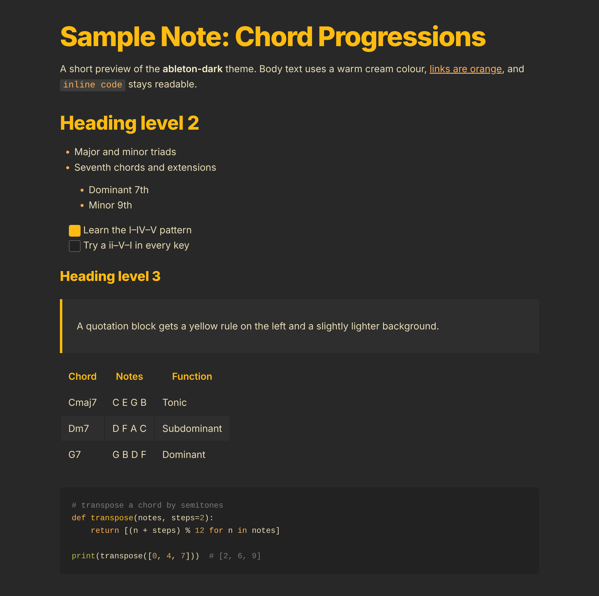

# Ableton Dark

A dark Typora theme with a charcoal background, warm cream body text and a yellow/orange accent.

This is a colour variant of [Typora Themeable](/theme/Typora-Themeable/) (dark) by John Hildenbiddle. Only the CSS colour variables are overridden; layout and typography come from Themeable.

## Features

- Charcoal background (`#282828`) with yellow headings and orange links, list markers and inline code
- Matching colours for the sidebar, tables, block quotes, checkboxes, search highlights and code blocks
- Code syntax colours tuned to the same yellow, orange and olive palette
- Print output switches to black text on white

## Install

1. Download the theme package.
2. Open Typora's theme folder (*Preferences → Appearance → Open Theme Folder*).
3. Copy `ableton-dark.css` into the theme folder.
4. Copy the `themeable/fonts` folder from the package into the theme folder too, so the Inter font loads. If you already have [Typora Themeable](/theme/Typora-Themeable/) installed, this folder is already there. Without it, the theme falls back to the system font.
5. Restart Typora and select **Ableton Dark** from the *Themes* menu.

## Notes

*Designed and tested on macOS. Not fully tested, but should work for Windows/Linux, since the platform-specific styles come from Typora Themeable.*

## License

MIT. Based on [Typora Themeable](https://github.com/jhildenbiddle/typora-themeable) © 2022-2024 John Hildenbiddle (MIT). Modifications © 2026 Hiroaki Satou.
