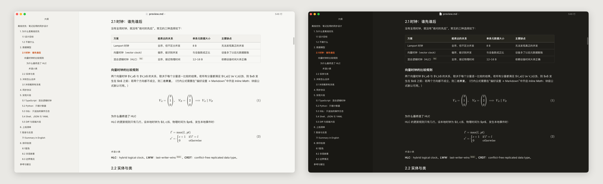
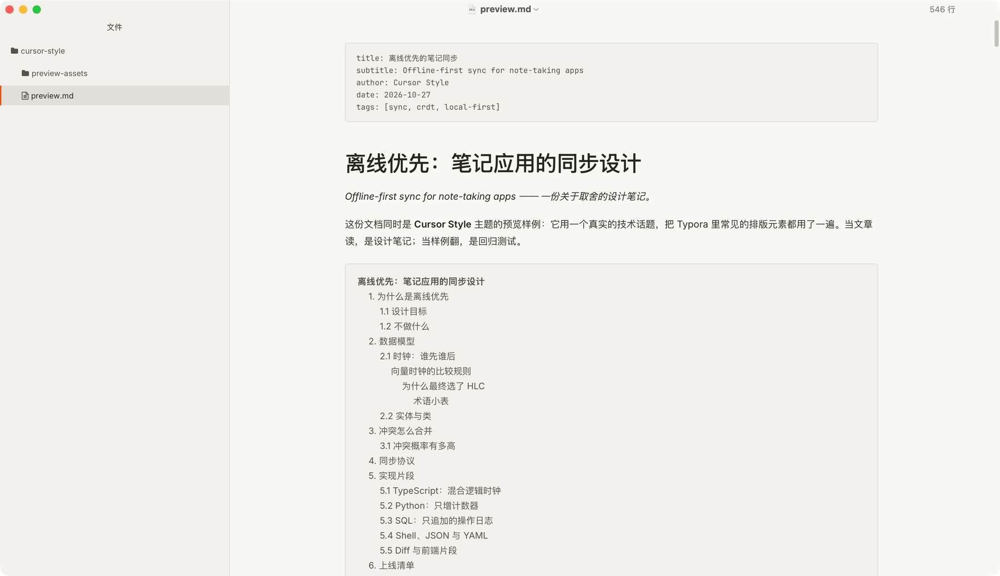
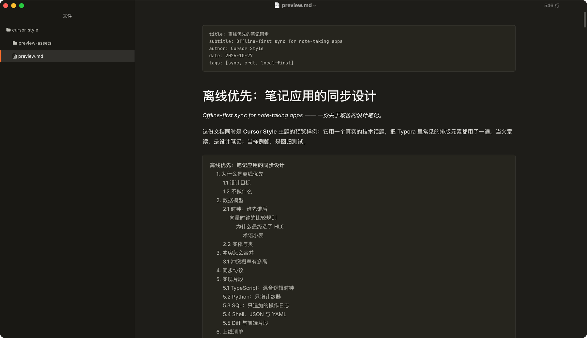
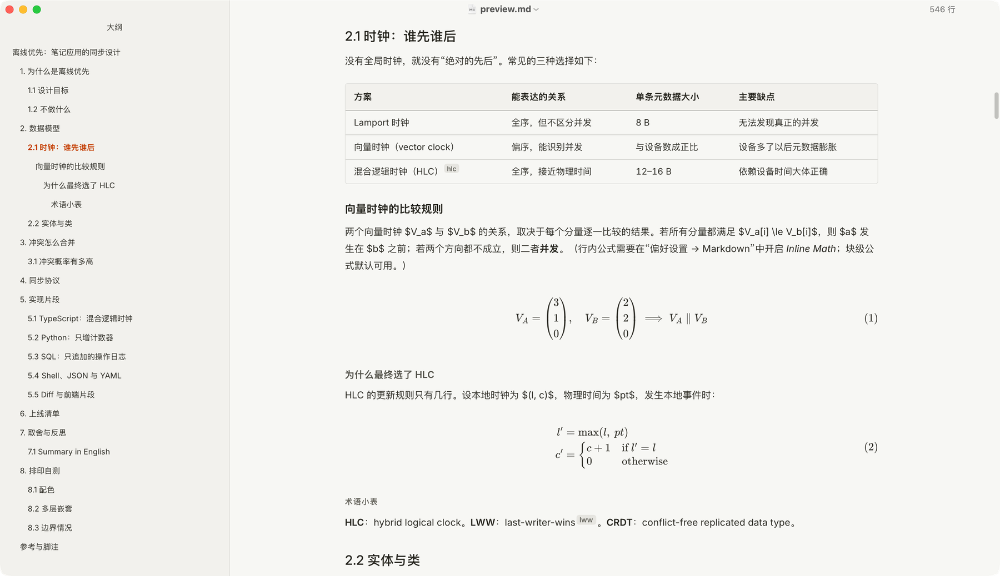
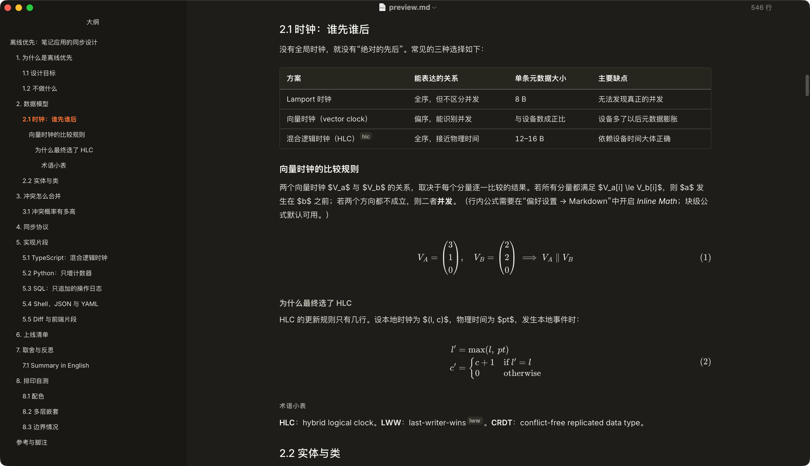
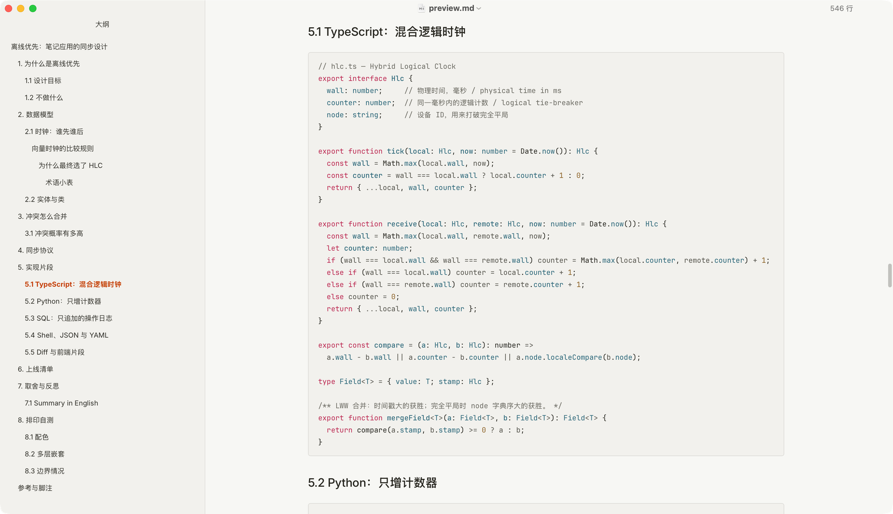
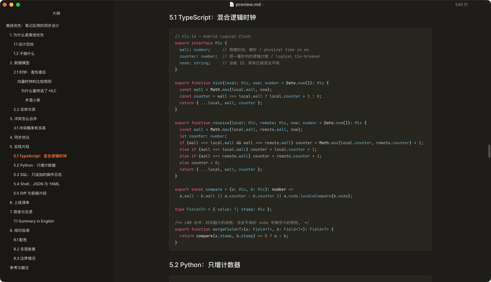
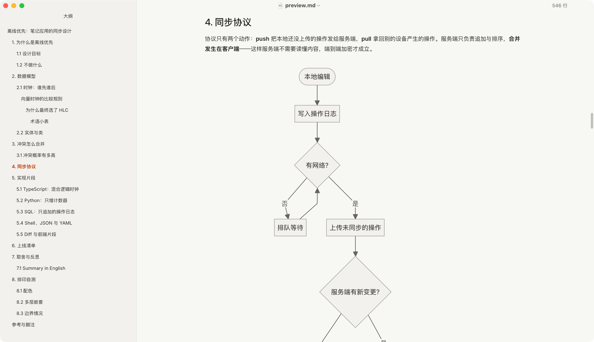
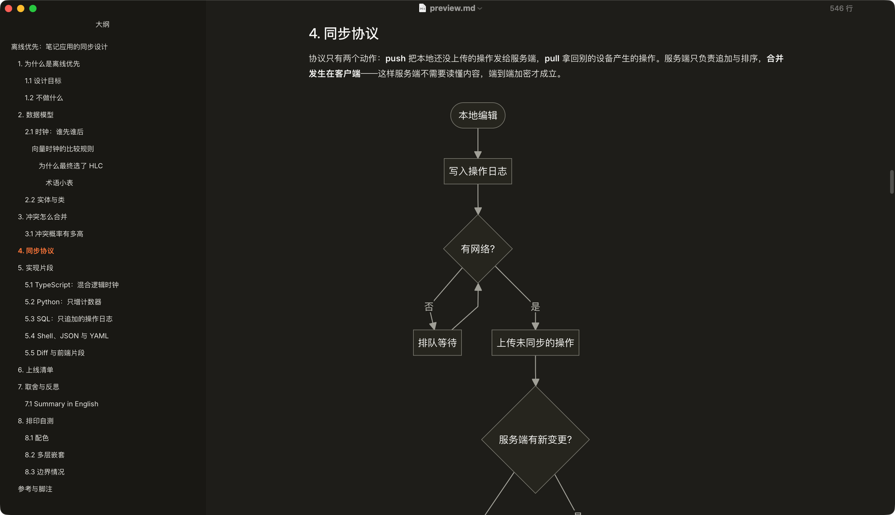

# Cursor Style

Cursor Style is built on Typora's GitHub theme, restyled in the visual language of Cursor's website: a warm paper background, ink-colored text, hairline borders and a sparing ember-orange accent. It keeps the GitHub theme's proven document skeleton and Typora's native editing behavior, and rewrites the colors, type hierarchy and display rules for long-form technical writing in English, Chinese, or both. A matching dark variant, **Cursor Style Dark**, is included.

Cursor Style is a community work inspired by Cursor's visual language. It is not affiliated with or endorsed by Anysphere / Cursor; "Cursor" in the name only says which style inspired it and is a trademark of its owner. The dark variant is derived from the same design tokens rather than being an official Cursor palette.

## Highlights

- **One text column:** paragraphs, headings, lists, quotes, code blocks, tables, images, math and Mermaid diagrams share the same left and right edges (56rem, about 896px, by default; set by `--cs-measure`). Wide content stays inside the column: code blocks wrap, or scroll when Typora's wrapping is off; tables with seven or more columns and display math scroll sideways; images and diagrams scale down.
- **Editorial typography:** light heading weights, 1.8 leading, Inter for text with the system CJK fonts, EB Garamond for quotes and JetBrains Mono for code, bundled as Latin subsets under the SIL Open Font License. Quotes, dashes and ellipses are left to the CJK font, so Chinese punctuation stays full-width.
- **Restrained color:** paper `#f7f7f4`, ink `#26251e`, and ember orange only for the caret, links, focus and active items. The brand orange is too light for small text on paper, so text and links use a deeper step that meets WCAG AA.
- **Complete coverage:** headings, lists, task lists, quotes, inline code, syntax highlighting, tables, images and captions, table of contents, footnotes, math, Mermaid, YAML front matter, search, focus mode, source mode, sidebar, scrollbars, menus, dialogs, and print styles. Every size is in `rem`, so Typora's font-size setting scales the whole theme.
- **Themed diagrams:** flowchart, state, sequence, class, ER, Gantt and pie diagrams share the palette in both variants.
- **Customizable:** override `--cs-measure`, `--cs-gutter`, `--cs-leading` or `--cs-code-ligatures` in `cursor-style.user.css`.

## Screenshots

### Reading

### Tables and math

### Code

### Diagrams

## Installation

1. Click **Download** above and extract the archive.
2. In Typora, open **Preferences → Appearance → Open Theme Folder** (**Settings** on Windows and Linux).
3. Copy `cursor-style.css`, `cursor-style-dark.css` and the whole `cursor-style/` folder into the theme folder.
4. Restart Typora and choose **Cursor Style** or **Cursor Style Dark** from the **Themes** menu. Preferences → Appearance can also assign a separate theme for dark mode.

## Compatibility

Designed and tested on macOS with Typora 1.5.6. Both variants were re-checked in reading view, with the sidebars, after the latest changes (scrollbars and heading spacing); editing, source and focus modes, search, narrow windows and HTML export of the light theme were checked on earlier revisions of the theme. Not tested on Windows or Linux, on other Typora versions, or with PDF export, and no styles specific to the Windows "unibody" window are included.

With the Mermaid bundled in Typora 1.5, pie chart legend labels longer than about twelve Chinese characters (plus the value) are clipped at the default column width, and any longer label is clipped when the text column is narrower than about 480px. The project README describes a one-line workaround.

## License and attribution

Cursor Style is released under the MIT License. It is built on the GitHub theme that ships with Typora; the parts derived from that theme remain under their original copyright. The bundled Inter, EB Garamond and JetBrains Mono fonts are distributed under the SIL Open Font License 1.1; their license texts are in `cursor-style/fonts/`.
