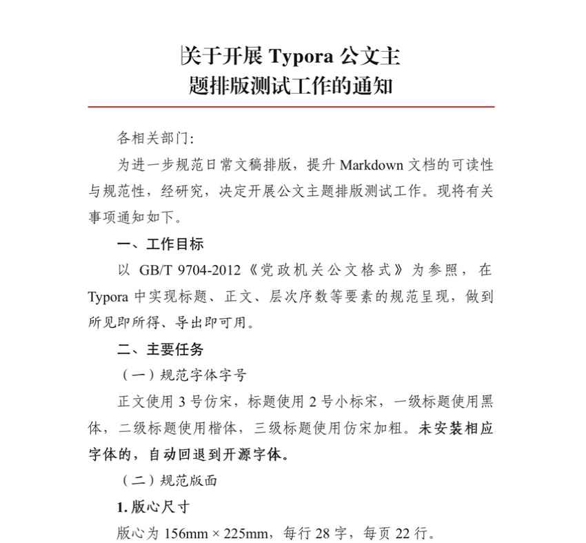
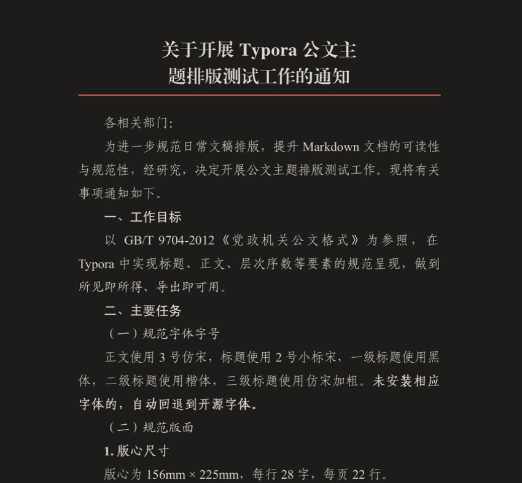

# Gongwen 公文

按照 **GB/T 9704-2012《党政机关公文格式》** 排版的 Typora 主题，提供亮色（Gongwen）与暗色（Gongwen Dark）两个版本。

A Typora theme that follows the Chinese official document standard GB/T 9704-2012, in light and dark variants.

## Highlights

- **Title** — 22pt XiaoBiaoSong, centered
- **Body** — 16pt FangSong, 2-character first-line indent, 28 characters per line
- **Heading levels** — `##` Hei · `###` Kai · `####` bold FangSong · `#####` FangSong, matching the “一、（一）1.（1）” hierarchy
- **Red rule** — `---` renders as the red separator line used in official documents
- **Print / PDF** — A4 with standard margins (37 / 35 / 28 / 26 mm) and fixed 22 lines per page
- **Dark mode** — warm ink palette, calibrated separately rather than inverted; prints in black on white
- **Font fallback** — uses locally installed fonts only, no bundled font files. Commercial fonts such as FZXiaoBiaoSong are used when present, otherwise the theme falls back to open-source Source Han Serif Heavy, Zhuque Fangsong and LXGW WenKai

## Screenshots

## Installation

1. Download and extract [Gongwen](https://github.com/MochiaoChen/typora-theme-gongwen/archive/refs/heads/main.zip).
2. In Typora, open **Preferences → Appearance → Open Theme Folder**.
3. Copy `gongwen.css` and `gongwen-dark.css` into the theme folder.
4. Restart Typora and select **Gongwen** or **Gongwen Dark** from the **Themes** menu.

## License

Gongwen is distributed under the [MIT License](https://github.com/MochiaoChen/typora-theme-gongwen/blob/main/LICENSE).
