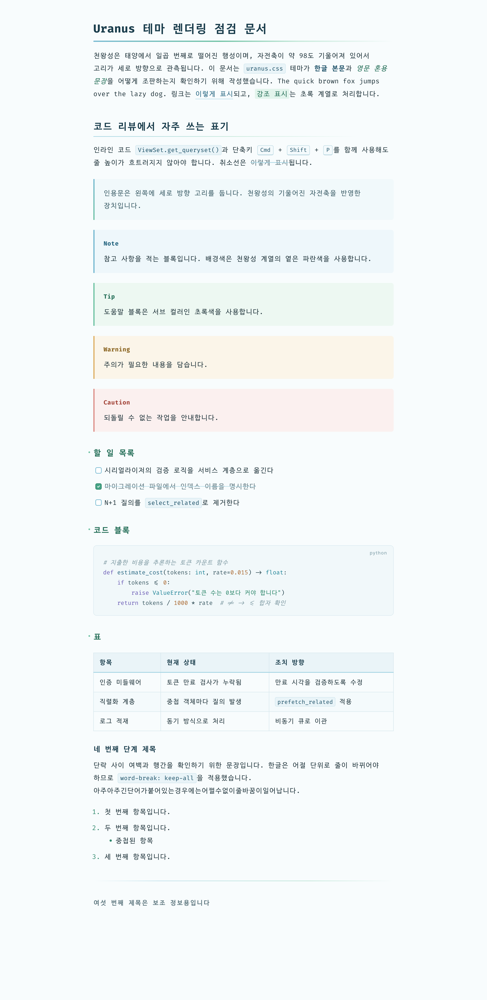
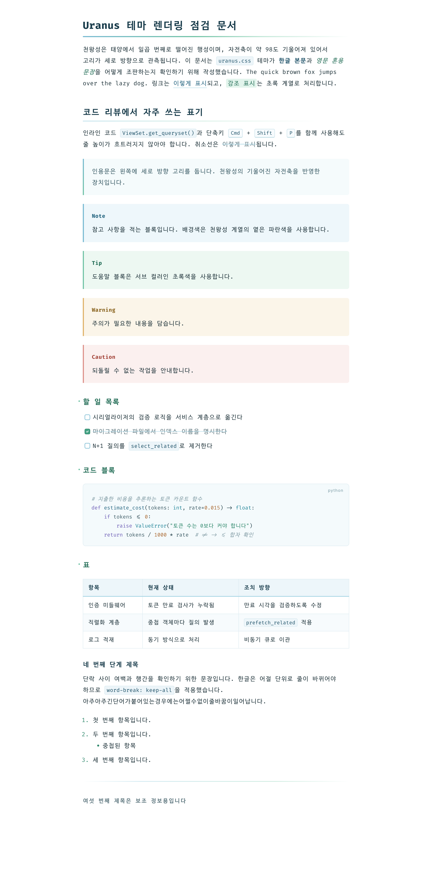
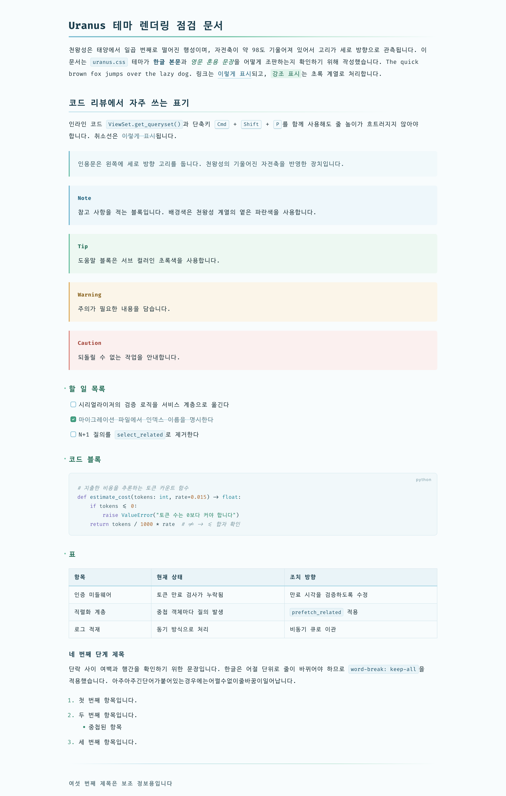

# Uranus

천왕성을 모티프로 삼은 Typora 라이트 테마입니다. 한글로 작성된 긴 리뷰 문서를 오랫동안 읽어도 눈이 덜 피로하도록 조판했습니다.

A light Typora theme inspired by Uranus, designed for reading long Korean (Hangul) review documents with less eye strain.

## Variants

| Theme | File | Background | Content width |
| --- | --- | --- | --- |
| Uranus | `uranus.css` | `#f8fcfd` (pale blue paper) | 820px |
| Uranus White | `uranus-white.css` | `#ffffff` | 820px |
| Uranus Wide | `uranus-wide.css` | `#f8fcfd` | 1100px |
| Uranus White Wide | `uranus-white-wide.css` | `#ffffff` | 1100px |

## Highlights

- **Hangul typesetting**: 1.9 line height, `word-break: keep-all` so lines never break inside a Korean word, no justified text. 820px width fits about 44 Hangul characters per line. Wide variants use 1100px with a 2.0 line height.
- **Fonts**: Fira Code for Latin and symbols, D2Coding ligature for Hangul. D2Coding ligature follows Fira Code's ligature rules, so `->`, `=>`, `!=` look consistent across both. Pretendard for the sidebar and menus. Falls back to the system monospace font when not installed.
- **Uranus motif**: a vertical blue-to-green "ring" on blockquotes (Uranus's rings are seen vertically because of its 98° axial tilt), and the same gradient as an underline on h1 and h2.
- **Color**: nine-step blue and eight-step green palettes as CSS variables. Link color `#256580` meets WCAG AA (about 6.2:1).
- **Review-friendly elements**: five GitHub-style alerts (`[!NOTE]`, `[!TIP]`, `[!IMPORTANT]`, `[!WARNING]`, `[!CAUTION]`), dimmed and struck-through completed tasks, language label on code blocks, striped tables, Mermaid and MathJax colors matched to the theme.
- **Print / PDF**: headings are kept with their content, code blocks and tables are not split across pages.

## Screenshots

## Installation

1. Download [typora-uranus-theme.zip](https://github.com/cosmos2/typora-uranus-theme/releases/latest/download/typora-uranus-theme.zip) from the latest release and extract it.
2. In Typora, open **Preferences → Appearance → Open Theme Folder**.
3. Copy the four CSS files **and the `uranus` folder** into the theme folder. The variants load each other with `@import`, so keep the files together.
4. Restart Typora and select **Uranus**, **Uranus White**, **Uranus Wide** or **Uranus White Wide** from the **Themes** menu.

Recommended fonts: [D2Coding](https://github.com/naver/d2codingfont), [Fira Code](https://github.com/tonsky/FiraCode), [Pretendard](https://github.com/orioncactus/pretendard). On macOS: `brew install --cask font-d2coding font-fira-code font-pretendard`.

Tested with Typora 1.14.9 on macOS.
