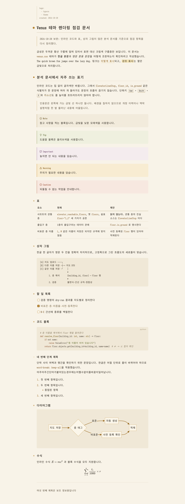
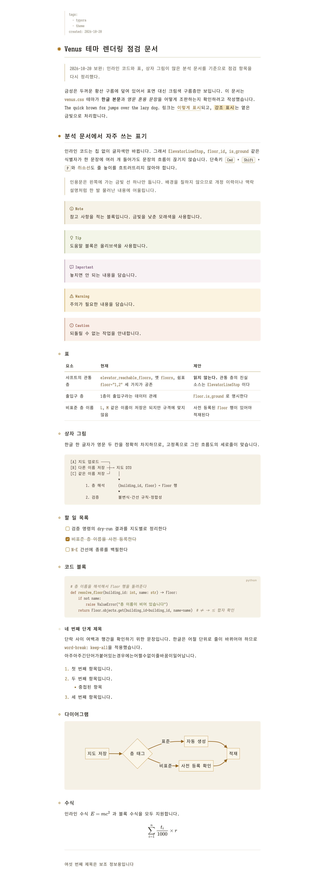
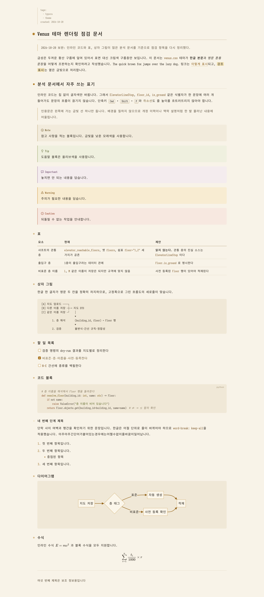

# Venus

금성을 모티프로 삼은 Typora 라이트 테마입니다. 한글로 작성된 긴 분석 문서를 오랫동안 읽어도 시선이 본문에 머물도록 조판했습니다.

A warm light Typora theme inspired by Venus, designed so your eyes stay on the text while reading long Korean (Hangul) analysis documents.

## Variants

| Theme | File | Background | Content width |
| --- | --- | --- | --- |
| Venus | `venus.css` | `#f8f3e8` (cream paper) | 820px |
| Venus White | `venus-white.css` | `#ffffff` | 820px |
| Venus Wide | `venus-wide.css` | `#f8f3e8` | 1100px |
| Venus White Wide | `venus-white-wide.css` | `#ffffff` | 1100px |

## Highlights

- **Nothing that pulls your eyes away**: one gold accent, used only for structure (list markers, heading marks, links, blockquote rule). Headings stay in the body ink color and are distinguished by size, weight and a margin mark. No gradients, striped rows or bordered chips.
- **Hangul typesetting**: 1.9 line height, `word-break: keep-all`, no justified text. 820px fits about 45 Hangul characters per line; Wide variants use 1100px with a 2.0 line height.
- **Fonts**: body in Sarasa Mono Slab K (Source Han Sans Hangul + Iosevka Slab Latin), where one Hangul character is exactly two Latin columns wide, so tables and indentation written in plain Markdown line up. Code blocks use Sarasa Term Slab K, which draws `→ ▼ …` at half width so box-drawing diagrams (`─ │ ┼ ▼`) align. Pretendard for the UI. Falls back to D2Coding and system fonts.
- **Venus motif**: heading marks follow the phases of Venus. A glowing gold disc for h1, a filled disc for h2, a ring for h3, a faint ring for h4.
- **Color**: warm only, no blue. Body `#2b251d` (13.7:1), link `#8a5a12` (5.3:1), inline code `#7a5424` (6.1:1), all above WCAG AA.
- **Analysis-friendly elements**: inline code changes only its text color (no chip), line-only tables with a minimum first-column width, a thin gold blockquote rule, small dimmed YAML front matter, five muted GitHub-style alerts, focus mode that fades other paragraphs into the paper, Mermaid and MathJax colors matched to the theme.
- **Print / PDF**: headings are kept with their content, code blocks and tables are not split across pages.

## Screenshots

## Installation

1. Download [typora-venus-theme.zip](https://github.com/cosmos2/typora-venus-theme/releases/latest/download/typora-venus-theme.zip) from the latest release and extract it.
2. In Typora, open **Preferences → Appearance → Open Theme Folder**.
3. Copy the four CSS files **and the `venus` folder** into the theme folder. The variants load each other with `@import`, so keep the files together.
4. Restart Typora and select **Venus**, **Venus White**, **Venus Wide** or **Venus White Wide** from the **Themes** menu.

Recommended fonts: [Sarasa Gothic](https://github.com/be5invis/Sarasa-Gothic) (Sarasa Mono Slab K, Sarasa Term Slab K) and [Pretendard](https://github.com/orioncactus/pretendard). On macOS: `brew install --cask font-sarasa-gothic font-pretendard`.

Tested with Typora 1.14.10 on macOS.
