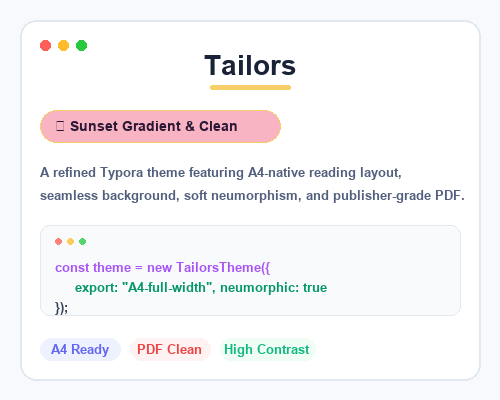

# Tailors Theme for Typora

**Tailors** is an elegant, warm, and refined theme for Typora, designed for writers, researchers, and technical document creators who value clarity, comfort, and beautiful typography.

It pairs a gentle, soothing paper canvas with signature sunset-gradient capsule headings, soft neumorphic cards, high-contrast syntax highlighting, and publisher-grade PDF export calibrated specifically for A4 paper.

## Features

- **Unified & Soothing Canvas** — Seamless, eye-friendly background tone across the entire writing environment without jarring pure-white cutout blocks.
- **Signature Sunset Capsule Headings** — Warm sunset gradients for H2 badges with soft hover micro-interactions, paired with clean hierarchical markers for H1–H6.
- **A4-Calibrated Layout** — Carefully tuned reading width on screen and true A4-page adaptation on export, eliminating awkward margins or horizontal overflow.
- **Publisher-Grade PDF & Print Output** — Dedicated print rules that automatically strip desktop UI shadows, prevent awkward page-breaks, and eliminate unwanted blue underlines or anchor artifacts.
- **Refined Inline Elements & Callouts** — Elegant inline code pills, distraction-free blockquotes with subtle lavender accents, and modern striped tables.
- **Developer-Friendly Code Blocks** — Clean macOS-style triple-dot window header with high-contrast, WCAG-compliant syntax colors for effortless code reading.
- **Bundled Offline Fonts** — Bundled with Bellota, Fira Code, Anonymous, and curated classical font fallbacks for an instant, out-of-the-box aesthetic.

## Preview

## Installation

1. Download **[tailors.zip](https://github.com/ChiamZhang/tailors.theme.typora/raw/gh-pages/media/theme/tailors/tailors.zip)**.
2. In Typora, open **Preferences → Appearance → Open Theme Folder**.
3. Extract `tailors.zip` and place `tailors.css` and the `tailors/` folder directly into your Typora theme folder.
4. Restart Typora or select **Tailors** from the **Themes** menu.

## Platform Note

Designed and thoroughly tested on macOS with standard WebKit properties. Fully compatible with Windows and Linux.

## License

Released under the [MIT License](https://opensource.org/licenses/MIT).
