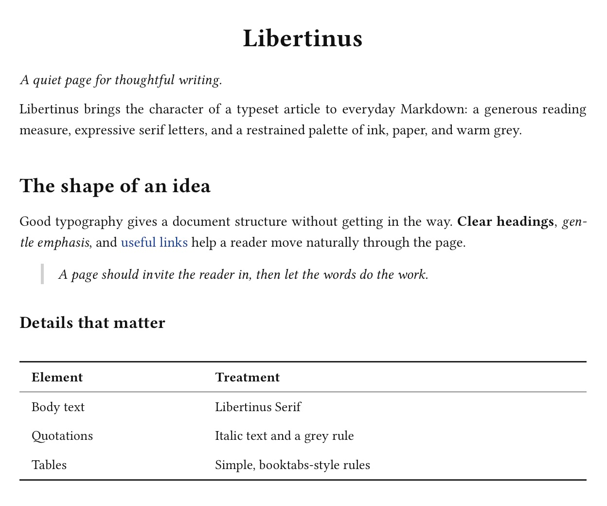
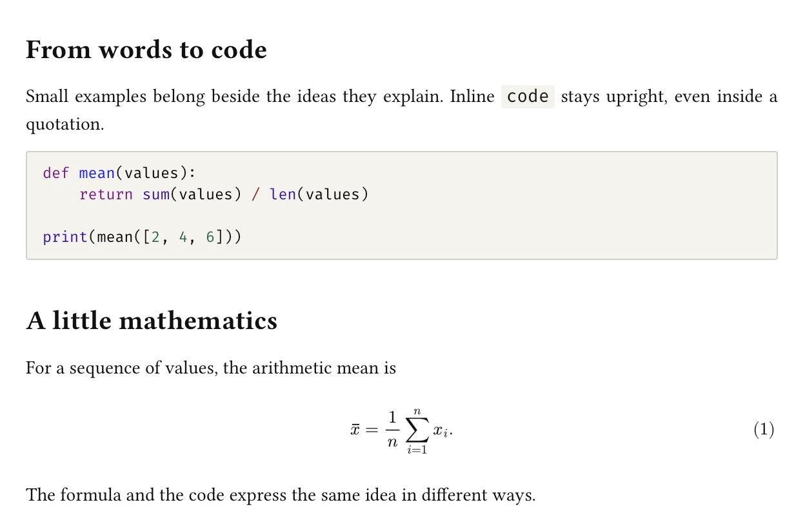
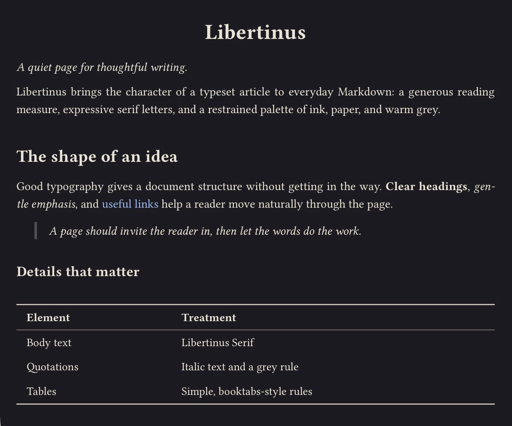
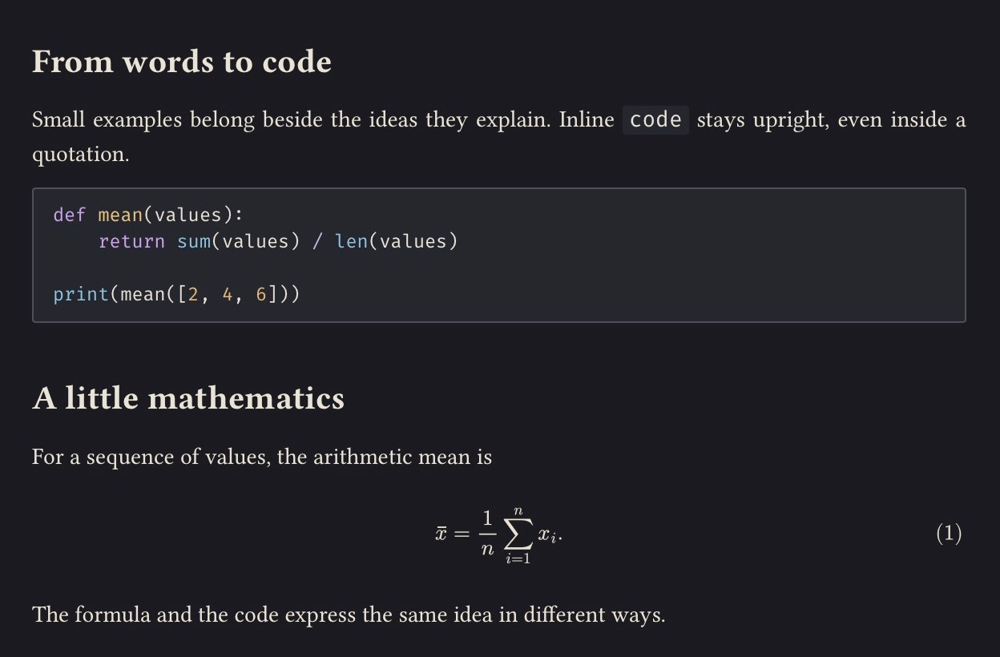

# Libertinus

Libertinus is a light and dark theme for notes, essays, and technical writing, inspired by the appearance of a Pandoc and XeLaTeX article.

## Features

- Libertinus Serif typography with an A4-inspired, 16 cm reading measure and LaTeX-style headings.
- Italic blockquotes with a narrow grey border, while quoted code stays upright.
- Simple tables with booktabs-style horizontal rules.
- Fira Code when installed, with monospace fallbacks. Warm grey or charcoal code blocks with an editable language selector below the code when the block is focused.
- 思源宋体 (Source Han Serif) for Chinese text when installed, with serif fallbacks.
- Two small CSS files sharing one layout, with no scripts or bundled fonts.
- A warm charcoal dark variant with matching syntax highlighting, source mode, and sidebar colors. Light print styling; choose Libertinus as the PDF export theme for white page margins.

## Installation

1. [Download Libertinus](https://github.com/wei-yuhang/typora-theme-libertinus/releases/download/v1.1.0/libertinus.zip) and unzip it.
2. In Typora, open **Preferences → Appearance → Open Theme Folder**.
3. Copy **both** `libertinus.css` and `libertinus-dark.css` into that folder. Keep them together: the dark variant imports the shared light stylesheet.
4. Restart Typora and choose **Themes → Libertinus** or **Libertinus Dark**.

For the intended typography, install **Libertinus Serif** and **Libertinus Sans** from the [official font releases](https://github.com/alerque/libertinus/releases). For Chinese text, install **思源宋体 (Source Han Serif)** from [Adobe’s releases](https://github.com/adobe-fonts/source-han-serif/releases). The screenshots also use [Fira Code](https://github.com/tonsky/FiraCode) for code. Fonts are not bundled; system fallbacks are used when they are unavailable. See the [README](https://github.com/wei-yuhang/typora-theme-libertinus#fonts) for the full font notes.

## Compatibility

The original light theme has been used long-term on **Windows** by the author. Both variants have been checked in **Typora 1.14.15 on macOS**, including code, math, source mode, sidebar layout, and PDF export. The new dark variant still needs Windows verification. **Linux has not been tested.**

For white PDF page margins while editing in dark mode, choose **Libertinus** in **Settings → Export → PDF → Theme**. Math rendering and PDF page size and margins follow Typora’s settings.

## License

[MIT](https://github.com/wei-yuhang/typora-theme-libertinus/blob/main/LICENSE). Fonts installed separately retain their own licenses.
