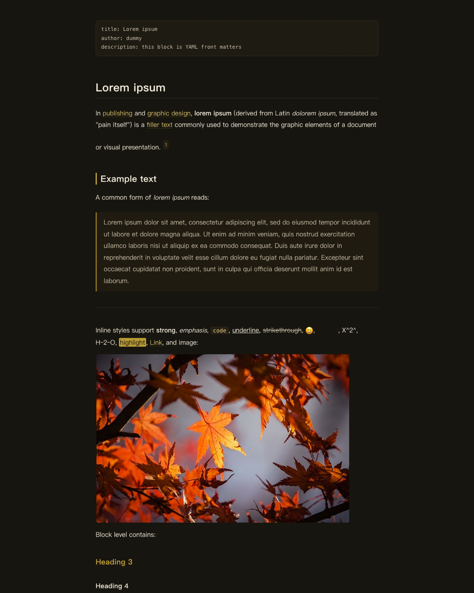
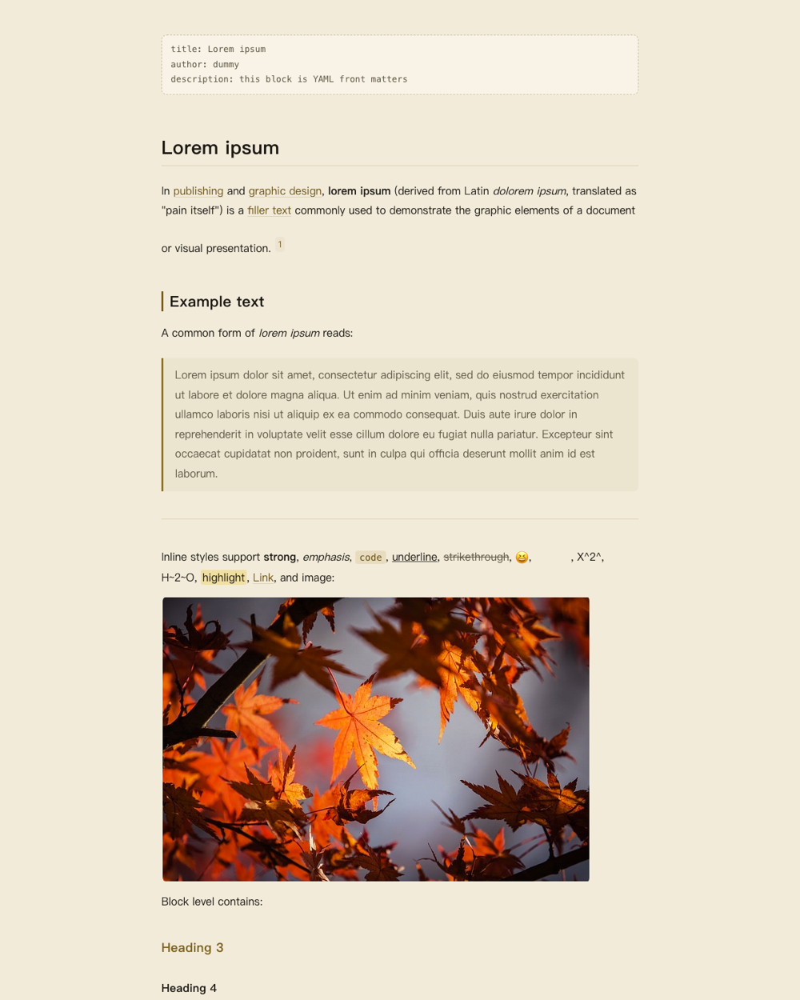
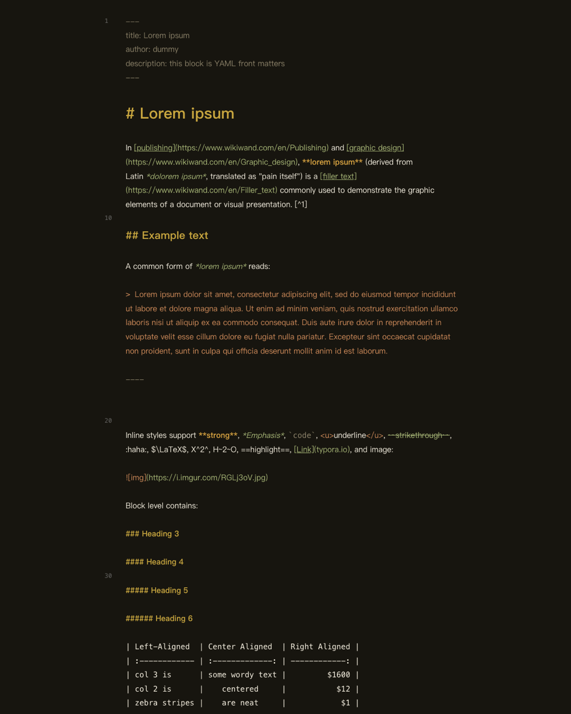
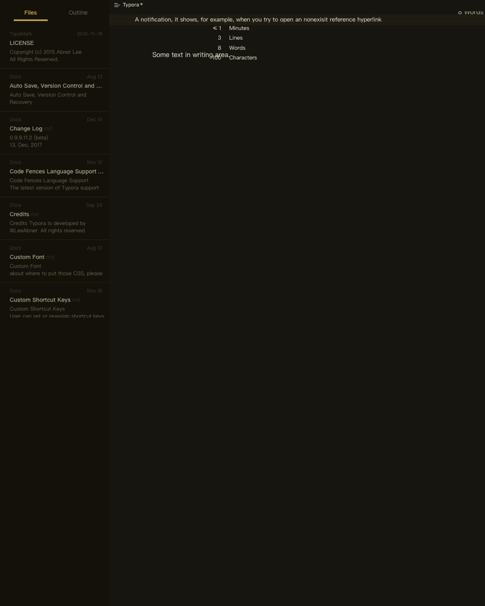

# Gilded Fortune

Gilded Fortune is a matched light and dark pair for Typora, built around one idea: **gold as structure, not decoration**. The dark variant is a warm near-black rather than a neutral gray; the light variant is the same palette re-derived as parchment. Both share a single structural stylesheet, so layout and colors never drift apart.

The accent is a gilded gold deliberately pulled back from full saturation — 55% instead of the 65% of a display gold — so long writing sessions stay comfortable rather than sparkling.

## Highlights

- **Two calibrated variants** — a warm near-black ground and a parchment light mode, derived from the same palette rather than inverted.
- **Contrast checked, not eyeballed** — an 80-assertion test suite verifies body text ≥ 7:1, secondary text, links, inline code, selections, table headers and every code token ≥ 4.5:1. The theme's brightness is also asserted, because Typora decides light/dark from the computed body background.
- **Full interface, not just the page** — sidebar, file tree, outline, footer, search panel, quick open, context menus, dialogs and the Windows/Linux megamenu are all themed, with the selected file row kept readable instead of dark-on-dark.
- **Restrained syntax highlighting** — code tokens stay inside a gold / olive / terracotta / parchment family, so blocks read as part of the document instead of a rainbow insert.
- **Both CodeMirror themes covered** — code fences (`.cm-s-inner`) and source mode (`.cm-s-typora-default`).
- **Reading-first typography** — 16px body on a 1.85 line height with a 780px measure; headings build hierarchy with size, weight and a thin gold rule. Font sizes use `rem` so Typora's own font-size preference keeps working.
- **No external dependencies** — system font stacks only. No bundled fonts, no remote imports, nothing to load offline.

## Screenshots

### Dark

### Light

### Source mode

### Sidebar

## Palette

| Role | Dark | Light |
|---|---|---|
| Page / body text | `#17150F` / `#F5EFE0` | `#F2EBDA` / `#1B1813` |
| Sidebar | `#131109` | `#EBE2CF` |
| Cards / dialogs | `#1E1B13` | `#F8F3E6` |
| Controls / inputs | `#221F15` | `#ECE4D0` |
| Borders | `#322C1C` | `#DED1B5` |
| Accent gold | `#C8A63F` | `#7A5F1A` |
| Links | `#D9C06B` | `#6B5316` |
| Code background | `#1C1912` | `#ECE3CD` |

## Installation

1. Download and extract [Gilded Fortune](https://github.com/mousebomb/typora-gilded-fortune/archive/refs/heads/main.zip).
2. In Typora, open **Preferences → Appearance → Open Theme Folder**.
3. Copy `gilded-fortune.css`, `gilded-fortune-light.css` and the `gilded-fortune/` folder into the theme folder — the CSS files must stay next to that folder, since the shared styles are pulled in with relative `@import`s.
4. Restart Typora and pick **Gilded Fortune** or **Gilded Fortune Light** from the **Themes** menu.

> Designed and tested on macOS with Typora 1.14. The Windows/Linux unibody interface is styled but not verified item by item — feedback is welcome.

## License

Gilded Fortune is released under the [MIT License](https://github.com/mousebomb/typora-gilded-fortune/blob/main/LICENSE). The palette is derived from the author's own page, with no third-party theme colors involved.
